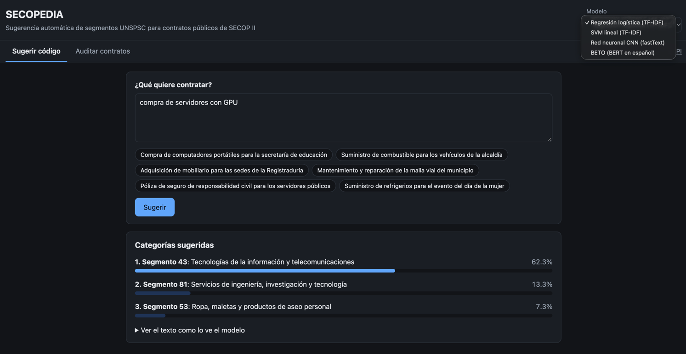
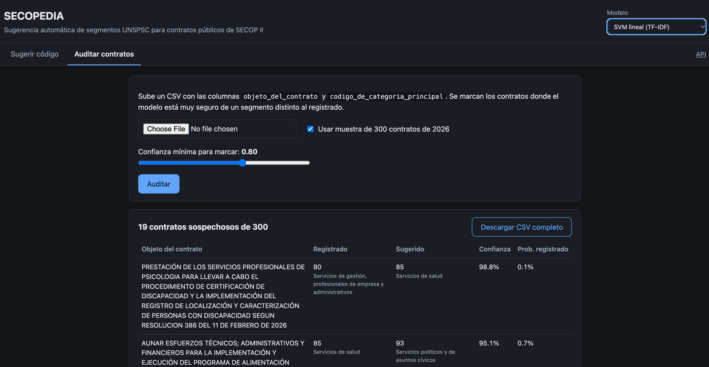
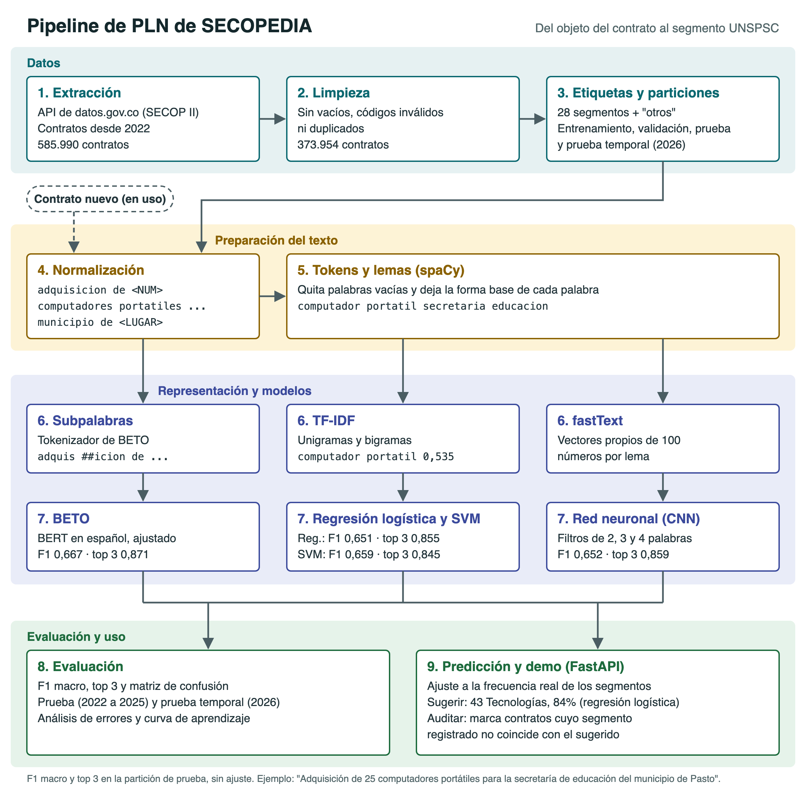

# SECOPEDIA

Clasificador automático de segmentos UNSPSC para contratos públicos colombianos de SECOP II.

## Descripción breve

Cuando una entidad pública publica un proceso en SECOP II debe clasificar lo que compra con un código del catálogo UNSPSC, y lo hace a mano entre miles de opciones. SECOPEDIA recibe el texto del objeto del contrato (por ejemplo "compra de computadores portátiles para la secretaría de educación") y sugiere los 3 segmentos UNSPSC más probables con su confianza. También puede auditar contratos ya publicados y marcar los que tienen una categoría que no coincide con su descripción.

- **Usuario principal:** funcionarios de contratación de entidades públicas.
- **Usuarios secundarios:** proveedores y pymes, veedurías y entes de control.
- **Tarea de PLN:** clasificación de texto multiclase supervisada (28 segmentos más la clase "otros").

## Demo en línea

**http://54.167.29.15/** ([documentación de la API](http://54.167.29.15/docs))

> **Servidor temporal:** se mantiene encendido para la entrega y la sustentación del proyecto. Después puede apagarse o cambiar de dirección. Si el enlace no responde, la demo se puede ejecutar manualmente. 

Se escribe lo que se quiere contratar y se obtienen los 3 segmentos más probables. En el selector se elige el modelo.



Así mismo se puede subir un CSV, o se usa la muestra de 300 contratos de 2026, y se marcan los que tienen una categoría que no coincide con su descripción.



## Pipeline de PLN



| Etapa | Módulo | Qué hace |
|---|---|---|
| 1. Extracción | `src/secopedia/extraccion.py` | Descarga desde la API de datos.gov.co solo las columnas necesarias, sin columnas de datos personales |
| 2. Limpieza | `src/secopedia/limpieza.py` | Quita textos vacíos, códigos inválidos, el código por defecto 801116 (personal temporal) y duplicados |
| 3. Etiquetas | `src/secopedia/etiquetas.py` | Código UNSPSC a segmento, clase "otros", tope por clase, particiones y prueba temporal |
| 4. Normalización | `src/secopedia/normalizacion.py` | Minúsculas, sin tildes, años a `<AÑO>`, números a `<NUM>` y municipios o departamentos (DIVIPOLA) a `<LUGAR>` |
| 5. Tokenización | `src/secopedia/tokenizacion.py` | spaCy `es_core_news_sm`: tokens, stopwords del español y del dominio, lemas |
| 6. Representación | `src/secopedia/representacion.py`, `modelos/red_neuronal.py` | TF-IDF de unigramas y bigramas de lemas; embeddings fastText propios; subpalabras de BETO |
| 7. Modelos | `src/secopedia/modelos/` | Línea base TF-IDF + Regresión Logística / SVM lineal; red neuronal CNN sobre fastText; fine-tuning de BETO |
| 8. Evaluación | `src/secopedia/evaluacion.py` | Accuracy, F1 macro, F1 ponderado, top-3 accuracy y matriz de confusión |
| 9. Demo | `src/secopedia/prediccion.py`, `src/secopedia/web/` | `predecir(texto)` (top 3) y `auditar(contratos)`, expuestos en una API FastAPI con interfaz web |

### Por qué se reemplazan los lugares

Los municipios y departamentos se cambian por `<LUGAR>` para que el modelo aprenda qué se compra y no dónde. La literatura muestra que depender de las entidades del texto puede dañar la generalización a otros dominios (Suntwal et al., 2019) y a datos futuros (Zhu et al., 2022), que es lo que mide la prueba temporal de 2026. 

Solo BETO recibe la marca `<LUGAR>`. En la regresión, la SVM y la CNN se descarta al lematizar, lo que equivale a borrar el lugar.

## Estructura

| Carpeta | Contenido |
|---|---|
| `configs/` | `config.yaml`: rutas, filtros, umbrales, semilla y repositorio de Hugging Face |
| `src/secopedia/` | Código del pipeline (una etapa por módulo) y la demo web |
| `scripts/` | Programas que encadenan las etapas: descargar, preparar, preprocesar y entrenar |
| `notebooks/` | `01` exploración de datos, `02` ejemplos de cada transformación, `03` evaluación y análisis de errores |
| `docker/`, `docker-compose.yml` | Imagen de la demo y proxy Caddy |
| `deploy/` | Scripts que se ejecutan en el servidor para desplegar y operar la demo |
| `docs/demo/` | Capturas de la demo |
| `docs/diagramas/` | Diagrama del pipeline (PNG y SVG) |
| `reports/` | Métricas (`metrics/`) y figuras (`figures/`) de todos los modelos |
| `tests/` | Pruebas unitarias |

## Instalación paso a paso

```bash
cd proyecto
python -m venv .venv
source .venv/bin/activate
pip install -r requirements.txt
pip install -e .
python -m spacy download es_core_news_sm
```

## Uso

### Solo la demo (sin descargar datos ni entrenar)

Los cuatro modelos entrenados y el léxico de lugares están publicados en Hugging Face ([crissebasbol/secopedia-beto-unspsc](https://huggingface.co/crissebasbol/secopedia-beto-unspsc)). Después de la instalación basta con:

```bash
uvicorn secopedia.web.servidor:app --port 8000
```

### Pipeline completo

```bash
# 1. Descargar los contratos (unos 586 mil, tarda varios minutos)
python scripts/descargar_datos.py

# 2. Limpiar y construir etiquetas y particiones
python scripts/preparar_datos.py

# 3. Construir la lista de municipios y departamentos para la normalización
python scripts/construir_lugares.py

# 4. Normalizar y lematizar las particiones
python scripts/preprocesar.py

# 5. Entrenar y evaluar la línea base
python scripts/entrenar_linea_base.py

# 6. Entrenar y evaluar la red neuronal (CNN sobre fastText, unos 4 minutos)
python scripts/entrenar_red_neuronal.py

# 7. Entrenar y evaluar BETO (alrededor de 1 hora con GPU)
python scripts/entrenar_beto.py

# 8. Abrir la demo: interfaz en http://localhost:8000 y documentación de la API en /docs
uvicorn secopedia.web.servidor:app --port 8000

# Pruebas
pytest
```

## Despliegue


Conéctate al servidor y ejecutar:

```bash
git clone https://github.com/crissebasbol/nlp-course.git
cd nlp-course/proyecto
deploy/preparar_servidor.sh   # una sola vez: instala Docker y crea 2 GB de swap
deploy/desplegar.sh           # construye la imagen, levanta la demo y espera a que responda
deploy/probar.sh              # prueba los cuatro modelos y la auditoría
```

La demo queda en `http://54.167.29.15/`.

### Operación

| Comando | Qué hace |
|---|---|
| `deploy/estado.sh` | Contenedores, memoria y disco |
| `deploy/registros.sh app` | Registros en vivo (`app` o `proxy`) |
| `deploy/detener.sh` | Detiene la demo y conserva los modelos descargados |


### Límites

- No tiene usuarios ni contraseñas: cualquiera que llegue al puerto 80 o 443 puede usarla. Para restringirla, limita las IP en el grupo de seguridad.
- Una auditoría a la vez, con máximo 5.000 contratos y archivos de hasta 10 MB. Las sugerencias siguen funcionando mientras tanto.

## Datos

SECOP II - Contratos Electrónicos, publicado por Colombia Compra Eficiente en datos.gov.co (id `jbjy-vk9h`). Se usan los contratos firmados desde 2022, excluyendo los de prestación de servicios, cuyo código UNSPSC es casi siempre el mismo.

## Resultados

| Modelo | F1 macro (prueba) | Top-3 (prueba) | F1 macro (prueba temporal 2026) | Top-3 (prueba temporal 2026) | ms por contrato |
|---|---|---|---|---|---|
| TF-IDF + Regresión Logística | 0,651 | 0,855 | 0,536 | 0,822 | 0,01 |
| TF-IDF + SVM lineal | 0,659 | 0,845 | 0,544 | 0,820 | 0,01 |
| CNN 1D sobre fastText | 0,652 | 0,859 | 0,534 | 0,839 | 0,01 |
| BETO (fine-tuning, 3 épocas) | **0,667** | **0,871** | **0,556** | **0,853** | 6 |

Los cuatro modelos están publicados en Hugging Face: [crissebasbol/secopedia-beto-unspsc](https://huggingface.co/crissebasbol/secopedia-beto-unspsc) (BETO en la raíz y los modelos clásicos en `clasicos/`). La demo los descarga automáticamente si no se entrenaron localmente. Las métricas completas están en `reports/metrics/` y en [`/api/metricas`](http://54.167.29.15/api/metricas).

BETO es el mejor en todas las métricas, sobre todo en top-3 con contratos nuevos (2026): en 85 de cada 100 el segmento correcto está entre las 3 sugerencias. A cambio, es unas 600 veces más lento por contrato (6 ms frente a 0,01 ms), aunque sigue siendo instantáneo para un usuario. El entrenamiento tomó 57 minutos con GPU. Los tiempos son de un mismo equipo y cambian según el hardware.

### Ajuste por distribución de clases

Los modelos se entrenan con un tope de contratos por segmento (clases casi balanceadas), pero en la realidad el segmento 80 es mucho más frecuente que, por ejemplo, el 95. La demo ajusta las probabilidades de cada modelo a la frecuencia real de los segmentos (calculada solo con contratos anteriores a 2026, archivo `reports/metrics/ajuste_distribucion.json`). En los contratos de 2026:

| Modelo | F1 macro sin ajuste | F1 macro con ajuste | Top-3 sin ajuste | Top-3 con ajuste |
|---|---|---|---|---|
| TF-IDF + Regresión Logística | 0,536 | 0,568 | 0,822 | 0,873 |
| TF-IDF + SVM lineal | 0,544 | 0,571 | 0,820 | 0,855 |
| CNN 1D sobre fastText | 0,534 | 0,564 | 0,839 | 0,876 |
| BETO | 0,556 | **0,591** | 0,853 | **0,888** |

Se puede desactivar con `prediccion.ajustar_distribucion: false` en `configs/config.yaml`.

### Ensamble y curva de aprendizaje

El promedio de las probabilidades de los cuatro modelos llega a F1 macro 0,680 y top-3 0,877 en prueba, un poco mejor que BETO solo. La demo usa los modelos por separado.

Con más datos de entrenamiento la mejora casi se detiene: al pasar de 105 mil a 284 mil contratos, la CNN gana menos de 1 punto de F1 y la regresión logística empeora (`scripts/curva_aprendizaje.py`, `reports/figures/curva_aprendizaje.png`).

## Referencias

- HaCohen-Kerner, Y., Miller, D. y Yigal, Y. (2020). The influence of preprocessing on text classification using a bag-of-words representation. *PLOS ONE, 15*(5), e0232525. https://doi.org/10.1371/journal.pone.0232525
- Suntwal, S., Paul, M., Sharp, R. y Surdeanu, M. (2019). On the Importance of Delexicalization for Fact Verification. *EMNLP-IJCNLP 2019*, 3413-3418. https://aclanthology.org/D19-1340/
- Uysal, A. K. y Gunal, S. (2014). The impact of preprocessing on text classification. *Information Processing & Management, 50*(1), 104-112. https://doi.org/10.1016/j.ipm.2013.08.006
- Zhu, Y., Sheng, Q., Cao, J., Li, S., Wang, D. y Zhuang, F. (2022). Generalizing to the Future: Mitigating Entity Bias in Fake News Detection. *SIGIR 2022*. https://arxiv.org/abs/2204.09484
