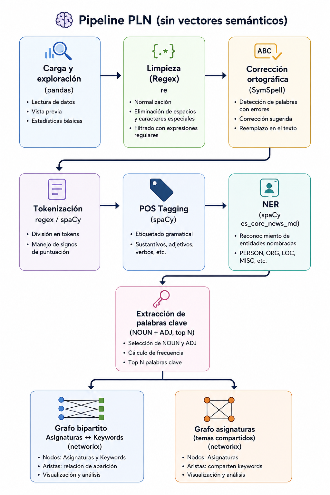
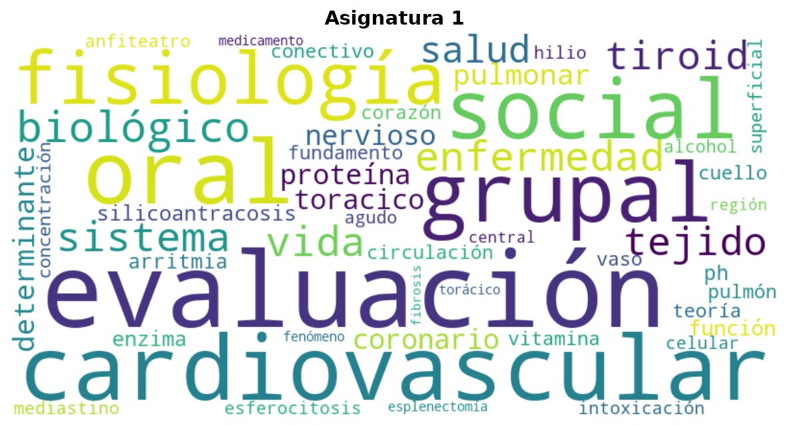
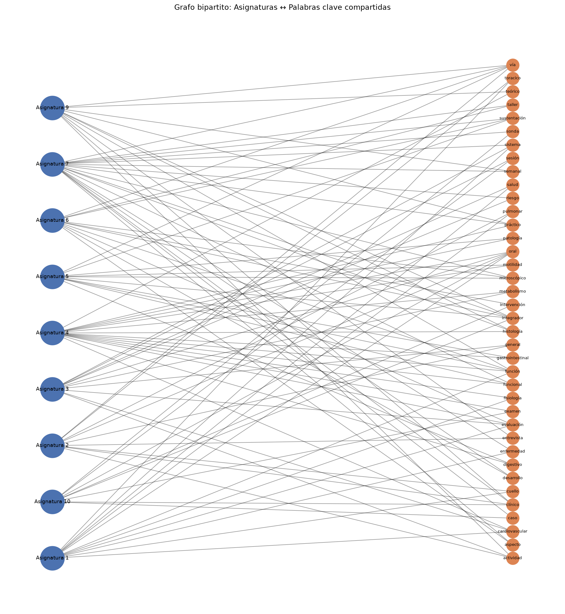
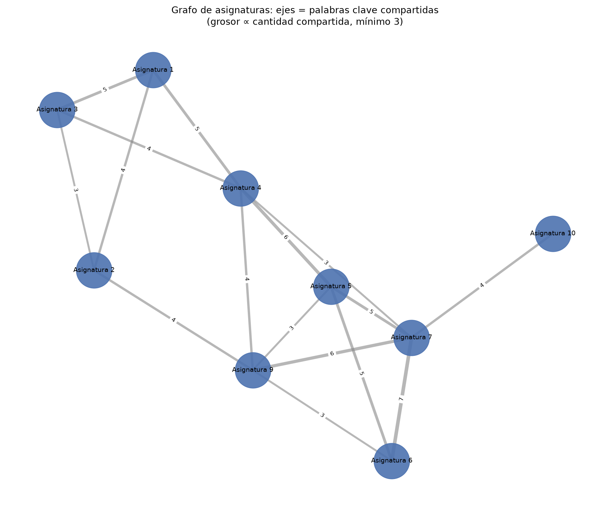

# Taller 1: Pipeline de PLN (sintaxis y corrección de términos)

**Datos:** `datos_finales.csv` : 3.276 temas de 9 asignaturas (contenido médico/salud)  
**Pregunta principal:** ¿Cuáles son los temas que comparten las asignaturas?

---

## 1. Pipeline PLN (sin vectores semánticos)



---

## 2. Ejemplos por etapa del pipeline

### Etapa 1 : Carga y exploración

| Asignatura    | Temas |
|---------------|------:|
| Asignatura 1  |   540 |
| Asignatura 2  |   245 |
| Asignatura 3  |   198 |
| Asignatura 4  |   326 |
| Asignatura 5  |   111 |
| Asignatura 6  |   130 |
| Asignatura 7  |   497 |
| Asignatura 9  |   485 |
| Asignatura 10 |   744 |

Ruido detectado:

| Patrón | Tipo | Ocurrencias |
|--------|------|------------|
| `\d+[-–]\d+\s*(am\|pm)` | Rangos horarios (`"9-11 am"`) | 9 |
| `\bEVALUACIÓN\b` | Marcadores de evaluación | 198 |
| `\bExamen\b` | Marcadores de examen | 167 |

También se detectó y corrigió el typo `"Asignatua 4"` → `"Asignatura 4"` (47 registros).

---

### Etapa 2 : Limpieza con Regex

Patrones aplicados:
- `\d{1,2}\s*[-–]\s*\d{1,2}\s*(?:am|pm)` → elimina rangos horarios
- `\d{1,2}:\d{2}\s*[-–]\s*\d{1,2}:\d{2}` → elimina horas exactas
- `[\r\n\t]+` → elimina caracteres de control
- `\s{2,}` → colapsa espacios múltiples

| Antes | Después |
|-------|---------|
| `'ESM-EVALUACIÓN 1ER PERIODO\r\nSYM NUTRICIÓN (9-11 am)'` | `'ESM-EVALUACIÓN 1ER PERIODO SYM NUTRICIÓN ()'` |
| `'Disfagia /  Trastorno de la motilidad gastrointestinal'` | `'Disfagia / Trastorno de la motilidad gastrointestinal'` |
| `'Taller \xa0de farmacodinamia...'` | `'Taller de farmacodinamia...'` (normalización unicode) |

---

### Etapa 3 : Corrección ortográfica (SymSpell)

Se construye un **diccionario de frecuencias del dominio** a partir del texto limpio (1.858 tokens únicos). Este enfoque es más adecuado que un diccionario genérico para texto médico especializado: SymSpell busca sugerencias con distancia de edición ≤ 1 solo para tokens de baja frecuencia (< 2 ocurrencias).

| Token original | Corrección sugerida | Distancia |
|---------------|---------------------|-----------|
| Ejemplo: `"farmacologıa"` | `"farmacología"` | 1 |
| Ejemplo: `"generles"` | `"generales"` | 1 |

---

### Etapa 4 : Tokenización (regex vs spaCy)

Estrategias comparadas:
- **Regex**: división simple por espacios y puntos (`re.split(r'[\s.]+', text)`) : la puntuación queda pegada a los tokens.
- **spaCy**: tokenizador con reglas del español : separa la puntuación como tokens independientes.

Diferencia clave con puntuación : texto: *`"Anfiteatro nariz senos paranasales, trigemino,fosa pterigopalatina y laringe/ Laboratorio de histología"`*

| Método | Tokens | Comportamiento |
|--------|--------|----------------|
| **Regex** | `['Anfiteatro', 'nariz', 'senos', 'paranasales,', 'trigemino,fosa', ...]` | Comas y barras quedan pegadas al token |
| **spaCy** | `['Anfiteatro', 'nariz', 'senos', 'paranasales', ',', 'trigemino', ',', 'fosa', ...]` | Separa cada símbolo como token propio |

Totales sobre el corpus completo (3.276 temas):

|  | regex | spaCy |
|--|------:|------:|
| **Total tokens** | 16.483 | 18.121 |
| **Tokens únicos** | 2.416 | 2.291 |
| **Promedio por tema** | 5,0 | 5,5 |

spaCy produce más tokens en total porque cuenta cada signo de puntuación por separado; sin embargo, tiene menos únicos porque los tokens limpios se repiten más. 

---

### Etapa 5A : POS Tagging (spaCy)

Ejemplo: *`"infección respiratoria alta"`*

| Token | POS | Lema |
|-------|-----|------|
| infección | NOUN | infección |
| respiratoria | ADJ | respiratorio |
| alta | ADJ | alto |

Ejemplo: *`"función de la terminal sináptica y neuroquímica de la sinapsis"`*

| Token | POS | Lema |
|-------|-----|------|
| función | NOUN | función |
| terminal | NOUN | terminal |
| sináptica | NOUN | sináptico |
| neuroquímica | ADJ | neuroquímico |
| sinapsis | NOUN | sinapsis |

Solo los tokens con POS `NOUN` o `ADJ`, sin stopwords y longitud ≥ 3, pasan a la extracción de keywords.

---

### Etapa 5B : NER (spaCy `es_core_news_md`)

El modelo identificó **1.762 temas** con al menos una entidad (Se hicieron pruebas con texto original limpio (conservando mayúsculas) y otro con todo el texto en minúsculas, donde el texto original limpio obtuvo un mejor el reconocimiento de entidades).

| Tipo entidad | Top ejemplos detectados |
|-------------|------------------------|
| LOC | `'Tutoria'`(104), `'Tutoria 2'`(60), `'Semiologia Abdomen'`(57) |
| MISC | `'Semiologia'`(94), `'Respiratorio'`(60), `'Seguimiento de tutores'`(42) |
| ORG | `'Grupo Viernes'`(54), `'Grupo Jueves'`(46), `'CMC'`(36) |
| PER | `'Cuello'`(41), `'faringe'`(14), `'Pared'`(10) |

> El modelo `es_core_news_md` fue entrenado en noticias; los términos médicos son clasificados de forma imprecisa (ej. `Tutoria` como LOC, `Cuello` como PER). Para NER biomédico preciso en español se recomienda un modelo especializado con anotaciones clínicas.

---

### Etapa 6 : Palabras clave por asignatura (Top 10)

| Asignatura | Top keywords |
|------------|-------------|
| Asignatura 1  | evaluación, cardiovascular, oral, social, grupal, fisiología, biológico, vida, enfermedad, sistema |
| Asignatura 2  | cardiaco, jueves, viernes, clínico, cuidado, casa, común, oral, semestre, dolor |
| Asignatura 3  | tutor, reunión, protocolo, oral, contexto, medida, salud, metabolismo, cardiorespiratorio, sesión |
| Asignatura 4  | evaluación, oral, gastrointestinal, fisiología, cardiovascular, patología, histología, boca, respiratorio, funcional |
| Asignatura 5  | sustentación, integrador, gastrointestinal, funcional, hígado, vía, ictericia, malabsorción, microscópico, vesícula |
| Asignatura 6  | renal, urinaria, vía, integrador, desarrollo, hidroelectrolítico, diabético, microscópico, suprarrenal, líquido |
| Asignatura 7  | integrador, riesgo, femenino, sustentación, masculino, clínico, sistema, semanal, abdominal, crecimiento |
| Asignatura 9  | integrador, miembro, vulnerabilidad, semanal, exploración, psicopatológico, chequeo, inferior, actividad, histología |
| Asignatura 10 | integrador, situación, piel, oral, examen, infección, diagnóstico, farmacológico, adulto, intervención |

Ejemplo wordcloud asignatura 1: 


---

## 3. Grafos y análisis

### Grafo bipartito (asignaturas ↔ keywords compartidas)



### Grafo de asignaturas (conexiones por temas compartidos)



### Análisis: ¿Cuáles son los temas que comparten las asignaturas?

El grafo de asignaturas generó **16 conexiones** entre las 9 asignaturas (umbral: ≥ 3 palabras clave compartidas en el top-30 de cada asignatura). La **Asignatura 4** es la más conectada (grado 5), actuando como nodo central que enlaza los sistemas digestivo, cardiovascular y respiratorio con las asignaturas morfoestructurales. La conexión más fuerte es **Asignatura 6 ↔ Asignatura 7** (7 keywords: *aspecto, desarrollo, integrador, microscópico, sustentación, taller, vía*), seguida de **Asignatura 4 ↔ Asignatura 5** (6 keywords: *digestivo, funcional, función, gastrointestinal, motilidad, patología*) y **Asignatura 7 ↔ Asignatura 9** (6 keywords: *clínico, histología, integrador, práctico, semanal, vía*).

Los temas transversales que conectan más asignaturas son *integrador*, *vía*, *función*, *microscópico* y *sustentación*. Los tres primeros reflejan vocabulario metodológico compartido (sesiones integradoras, vías de abordaje, evaluación funcional) que aparece en casi todas las asignaturas como estructura pedagógica del currículo. En cambio, *histología* y *microscópico* son indicadores de contenido médico real: indican que varias asignaturas incluyen estudio de tejidos y morfología celular, típico de un currículo preclínico-clínico integrado.

Las asignaturas comparten principalmente dos tipos de temas. Primero, **contenido de sistemas orgánicos**: el eje digestivo/gastrointestinal conecta Asignaturas 4 y 5; el cardiovascular conecta Asignaturas 1, 3 y 4; la histología y la práctica clínica conectan las Asignaturas 7 y 9. Segundo, **estructura pedagógica transversal**: términos como *integrador*, *semanal* y *sustentación* evidencian un currículo con sesiones de integración periódicas que atraviesan todas las asignaturas. Las asignaturas con menor conectividad (Asignatura 2 con vocabulario cardíaco muy específico, y Asignatura 3 centrada en tutores y protocolos) tienen perfiles temáticos más acotados.

---

## Instalación y ejecución

```bash
# 1. Crear entorno virtual
python3 -m venv .venv
source .venv/bin/activate  # Windows: .venv\Scripts\activate

# 2. Instalar dependencias
pip install -r requirements.txt

# 3. Descargar modelo de spaCy en español
pip install https://github.com/explosion/spacy-models/releases/download/es_core_news_md-3.8.0/es_core_news_md-3.8.0-py3-none-any.whl

# 4. Correr el pipeline completo
cd src
python3 pipeline.py

# O correr cada paso individualmente
python3 step01_load_explore.py
python3 step02_clean.py
# ...
```

Los resultados (gráficos, CSVs intermedios) se guardan en `outputs/`.

## Librerías utilizadas

| Librería | Uso |
|----------|-----|
| `pandas` | Carga y manipulación de datos |
| `re` | Limpieza con expresiones regulares |
| `spacy` | Tokenización, POS tagging, NER |
| `symspellpy` | Corrección ortográfica (diccionario de dominio) |
| `matplotlib` | Visualizaciones |
| `networkx` | Construcción y análisis de grafos |
| `wordcloud` | Nubes de palabras por asignatura |
