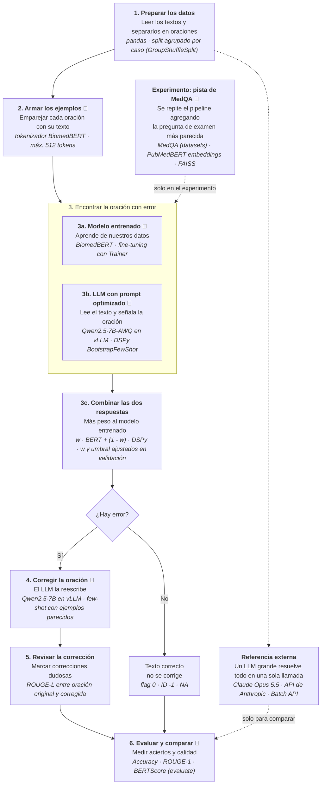

# Taller 7: Pipeline para detección y corrección de errores médicos (MEDEC / MEDIQA-CORR 2024)

## Objetivo

1. Leer los artículos de referencia:
   - *MEDEC: A Benchmark for Medical Error Detection and Correction in Clinical Notes* (Ben Abacha et al., 2025).
   - *WangLab at MEDIQA-CORR 2024: Optimized LLM-based Programs for Medical Error Detection and Correction* (Toma et al., 2024).
2. Revisar el dataset de entrenamiento **MEDIQA-CORR 2024 MS**.
3. Plantear un pipeline que resuelva las tareas con modelos de **Hugging Face**, indicando el modelo a usar y las funciones a programar en cada etapa.

## Archivos

| Archivo | Descripción |
|---|---|
| `analisis_dataset.ipynb` | Análisis exploratorio del dataset, con gráficas y conclusiones. |
| `data/MEDIQA-CORR-2024-MS-TrainingData.csv` | Conjunto de entrenamiento MS (2.189 textos clínicos). |
| `data/*.pdf` | Artículos de referencia. |
| `requirements.txt` | Dependencias para ejecutar el notebook. |
| [`pipeline.html`](pipeline.html) | (Opcional) Versión interactiva del diagrama del pipeline: se abre en cualquier navegador, sin instalar nada, y al hacer clic en cada caja muestra su detalle. |

## Cómo ejecutar el análisis

```bash
python -m venv .venv && source .venv/bin/activate
pip install -r requirements.txt
jupyter notebook analisis_dataset.ipynb
```

## La tarea

Cada texto clínico es **correcto o tiene exactamente un error** médico (diagnóstico, manejo, tratamiento, farmacoterapia u organismo causal). Hay tres subtareas:

| Subtarea | Entrada | Salida | Métrica |
|---|---|---|---|
| **A. Error flag** | Texto clínico | `0` / `1` | Accuracy |
| **B. Error sentence** | Texto segmentado en oraciones | ID de la oración con error, `-1` si no hay | Accuracy |
| **C. Corrección** | Texto + oración con error | Oración corregida, `NA` si no hay error | ROUGE-1, BERTScore |

### Métricas de evaluación

Se usan tres de las métricas oficiales del shared task MEDIQA-CORR 2024, descritas en la sección 5.2 de MEDEC y en la sección 3 del artículo de WangLab ([scripts de evaluación](https://github.com/abachaa/MEDIQA-CORR-2024/tree/main/evaluation)). En las métricas de corrección se compara la oración generada con la de referencia.

| Métrica | Subtarea | Qué mide | Ejemplo |
|---|---|---|---|
| **Accuracy** | A y B | Porcentaje de textos donde la predicción coincide con la etiqueta (el flag en A, el ID de la oración en B). | Si de 100 textos se acierta el flag en 70, la accuracy de A es 0,70. |
| **ROUGE-1** | C | Traslape de palabras individuales (unigramas) entre la corrección generada y la de referencia, como F1 de precisión y recall. | Referencia: *"The causal pathogen is Streptococcus pneumoniae."* Generada: *"The causal pathogen is Streptococcus pyogenes."* Coinciden 5 de 6 palabras, así que el puntaje es alto aunque la bacteria esté mal. |
| **BERTScore** | C | Similitud de significado: compara los embeddings de cada token con un modelo BERT (`microsoft/deberta-xlarge-mnli`), así que da puntaje parcial a palabras parecidas aunque no sean idénticas. | *"Patient is diagnosed with X-linked agammaglobulinemia"* frente a *"... Bruton agammaglobulinemia"*: puntúa mejor que ROUGE porque los embeddings son cercanos, aunque las palabras sean distintas. |

## Hallazgos del dataset que guían el diseño

Detalle completo en `analisis_dataset.ipynb`.

- **55,7%** de los textos tienen error: clases casi balanceadas.
- Textos cortos (mediana 167 tokens, máximo 414 con el tokenizador de BiomedBERT): **caben completos en un encoder de 512 tokens** junto con la oración candidata.
- El error está en la **última oración en el 62,5%** de los casos: hay un sesgo de posición fuerte.
- Solo hay **1.240 casos clínicos distintos**: 934 aparecen dos veces (versión correcta y versión con error). El split de validación debe ser **agrupado por caso**.
- La corrección es casi siempre el **reemplazo de una entidad** (82,5% cambia un solo bloque; mediana de 2 palabras).
- Los textos MS se construyeron a partir de preguntas de opción múltiple de **MedQA**. Buscar la pregunta original equivale a consultar la respuesta, así que se deja fuera del pipeline principal y se evalúa como experimento aparte.

## Pipeline propuesto

La idea combina lo mejor de los dos artículos con modelos abiertos de Hugging Face que se pueden correr en Colab:

- Del artículo de **WangLab**: descomponer el problema en *detectar, localizar y corregir* y optimizar los prompts del LLM con **DSPy**.
- De **MEDEC**: los LLM solos tienen baja precisión (detectan errores donde no los hay); por eso, además del LLM, se entrena un **clasificador biomédico fine-tuneado** con umbral calibrado.

Para la detección (subtareas A y B) se usan **dos detectores en paralelo** y se combinan con un promedio ponderado:

1. **Detector fine-tuneado:** BiomedBERT ajustado con nuestros datos. Da una probabilidad de error por oración.
2. **Detector DSPy:** Qwen2.5-7B con un programa DSPy compilado, como en WangLab pero con un modelo abierto. Devuelve la oración sospechosa y una confianza.

Así se comparan las dos estrategias (cambiar los pesos del modelo frente a optimizar el prompt) y, además, se aprovecha lo mejor de ambas.

Como **referencia externa** se evalúa además un LLM grande vía API, **Claude Opus 5.5**, con el mismo tipo de prompt que usó MEDEC y sin entrenamiento ni optimización. No entra en la combinación: sirve para saber qué tan lejos queda nuestro pipeline de un modelo comercial grande y para comparar directamente con la tabla del artículo.

El pipeline principal **no usa MedQA**: los modelos solo ven el texto clínico. Usar MedQA (como hizo WangLab) se evalúa en un **experimento aparte** para medir cuánto sube el resultado al tener esa pista.

En el diagrama, 🤗 marca los pasos que usan modelos, datasets o librerías de Hugging Face.

> **Opcional:** para explorar el diagrama de forma interactiva, abre [`pipeline.html`](pipeline.html) en el navegador.



#### Resumen paso a paso

| Paso | Qué hace | Con qué |
|---|---|---|
| **1. Preparar los datos** | Lee los textos, reconstruye las oraciones y separa entrenamiento y validación sin repetir un mismo caso clínico en los dos lados. | pandas |
| **2. Armar los ejemplos** | Convierte cada texto en pares *(oración, texto completo)*, que es lo que recibe el modelo entrenado. | Tokenizador de BiomedBERT 🤗 |
| **3a. Modelo entrenado** | Aprende con nuestros datos a decir qué tan probable es que cada oración sea el error. | BiomedBERT con fine-tuning 🤗 |
| **3b. LLM con prompt optimizado** | Un LLM lee el texto y señala la oración sospechosa. DSPy elige los ejemplos que mejor funcionan en su prompt. | Qwen2.5-7B + DSPy 🤗 |
| **3c. Combinar las dos respuestas** | Promedia las dos opiniones dando más peso al modelo entrenado. Si ninguna oración es lo bastante sospechosa, el texto se considera correcto. | - |
| **4. Corregir la oración** | El LLM reescribe la oración con error usando su conocimiento médico y ejemplos parecidos del entrenamiento. | Qwen2.5-7B 🤗 |
| **5. Revisar la corrección** | Si la corrección quedó igual o cambió demasiado, se marca como dudosa para analizarla. | ROUGE 🤗 |
| **6. Evaluar y comparar** | Mide los aciertos en detección (A y B) y la calidad de la corrección (C) de cada sistema. | `evaluate` 🤗 |
| **Referencia externa** | Un LLM comercial grande resuelve las tres subtareas sin entrenamiento, solo para comparar. | Claude Opus 5.5 (API) |
| **Experimento: pista de MedQA** | Repite los pasos 3 a 5 dándoles además la pregunta de examen más parecida y su respuesta, para medir cuánto ayuda esa "hoja de respuestas". | MedQA + PubMedBERT embeddings 🤗 |

El detalle técnico de cada paso (funciones a programar) está en la sección siguiente.

### Modelos y recursos

| Rol | Modelo / dataset / librería | ¿De Hugging Face? | Por qué |
|---|---|---|---|
| Detector fine-tuneado (A y B) | [`microsoft/BiomedNLP-BiomedBERT-base-uncased-abstract-fulltext`](https://huggingface.co/microsoft/BiomedNLP-BiomedBERT-base-uncased-abstract-fulltext) | Sí: modelo del Hub, se entrena con `transformers` | Encoder preentrenado en PubMed: entiende vocabulario médico y se puede fine-tunear en una T4. |
| LLM (detector DSPy y corrector) | [`Qwen/Qwen2.5-7B-Instruct-AWQ`](https://huggingface.co/Qwen/Qwen2.5-7B-Instruct-AWQ) | Sí: modelo del Hub, cuantizado a 4 bits (AWQ) | LLM instruccional abierto que cabe en una T4. Se sirve **una sola vez** con vLLM y lo usan el detector DSPy y el corrector. |
| Embeddings | [`NeuML/pubmedbert-base-embeddings`](https://huggingface.co/NeuML/pubmedbert-base-embeddings) | Sí: modelo del Hub, se usa con `sentence-transformers` | Sentence-transformer biomédico. En el pipeline principal elige ejemplos parecidos del train para el corrector; en el experimento, busca preguntas de MedQA. |
| Optimización de prompts | [DSPy](https://dspy.ai) | No: librería de Stanford | Compila el detector LLM (elige ejemplos few-shot según una métrica), como en WangLab. |
| Servidor del LLM | [vLLM](https://docs.vllm.ai) | No, pero descarga el modelo desde el Hub | Expone Qwen con una API compatible con OpenAI, que es lo que DSPy sabe llamar; procesa muchas peticiones en paralelo. |
| Referencia: LLM grande | `claude-opus-5-5` con el SDK oficial `anthropic` | No: API de pago de Anthropic | Modelo comercial grande, comparable con los LLMs que evaluó MEDEC (incluido Claude 3.5 Sonnet). Se usa con *structured outputs* y Batch API. |
| Métricas | `evaluate` (ROUGE), `bert-score` | `evaluate` sí; BERTScore usa `microsoft/deberta-xlarge-mnli` del Hub | ROUGE-1 y BERTScore, comparables con los artículos. |
| Experimento: base de conocimiento | [`GBaker/MedQA-USMLE-4-options`](https://huggingface.co/datasets/GBaker/MedQA-USMLE-4-options) | Sí: dataset del Hub, se carga con `datasets` | Preguntas de examen con opciones y respuesta correcta, origen de los textos MS. Solo se usa en el experimento. |

