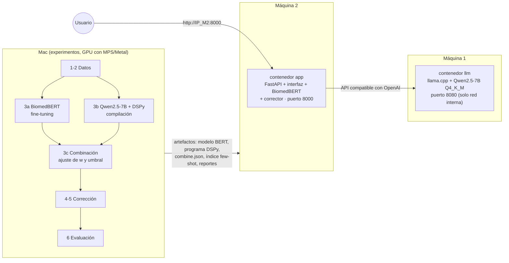
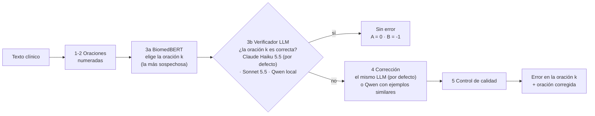

# Taller 8: Implementación del pipeline MEDEC / MEDIQA-CORR 2024

Implementación del pipeline diseñado en el [taller 7](../taller_7/README.md) para **detectar y corregir errores médicos en textos clínicos**, con el dataset MS de ese taller. Resuelve las tres subtareas:

| Subtarea | Pregunta | Métrica |
|---|---|---|
| A | ¿El texto tiene un error? | Accuracy |
| B | ¿En qué oración está? | Accuracy |
| C | ¿Cómo debería quedar la oración? | ROUGE-1 y BERTScore |

El proyecto incluye el código del pipeline, los scripts que lo ejecutan paso a paso, una interfaz web para probar los modelos y los scripts para desplegarlo con Docker en dos servidores.

> **Resumen:** el diseño original del taller 7 (BiomedBERT + Qwen2.5-7B con DSPy) se implementó tal cual y se evaluó. Después se iteró sobre él; la versión final usa **BiomedBERT para elegir la oración y Claude Haiku 5.5 para decidir si es correcta y corregirla**, y pasa de A = 0,57 a **0,83** en test. El recorrido completo está en [Iteraciones](#iteraciones-qué-probamos-después-del-pipeline-original) y el diagrama final en [Pipeline final](#pipeline-final).

## Arquitectura

Diagrama del pipeline **original** (diseño del taller 7) y de su despliegue. La versión final, después de iterar, está en [Pipeline final](#pipeline-final).



**Por qué esta división:**

- Los servidores no tienen GPU (4 vCPU y ~7,7 GB de RAM libre cada uno). Entrenar BiomedBERT y compilar DSPy ahí tomaría horas, así que **lo pesado se hace en el Mac** y a los servidores solo se copian los modelos ya entrenados.
- Qwen2.5-7B cuantizado a 4 bits ocupa ~5,5 GB de RAM: no cabe junto a la app en una sola máquina. Por eso **la máquina 1 solo sirve el LLM** y la **máquina 2 sirve la app**.
- El LLM escucha en el puerto 8080, que no está abierto a internet. Solo la app (puerto 8000) es pública.
- En el Mac, BERT y el LLM no caben juntos en la memoria de la GPU, así que se ejecutan por turnos.

## Estructura

```
taller_8/
├── configs/default.yaml       # rutas, modelos, semillas e hiperparámetros
├── src/medec/                 # código del pipeline, un módulo por caja del diagrama
│   ├── data.py                # 1. carga, parseo de oraciones y split por caso clínico
│   ├── pairs.py               # 2. pares (oración, texto completo)
│   ├── baselines.py           # baseline "siempre la última oración"
│   ├── detector_bert.py       # 3a. BiomedBERT con fine-tuning
│   ├── llm_server.py          # cliente del servidor llama.cpp
│   ├── detector_dspy.py       # 3b. detector Qwen + DSPy
│   ├── combine.py             # 3c. combinación ponderada y decisión
│   ├── corrector.py           # 4. corrección con few-shot
│   ├── quality.py             # 5. control de calidad
│   ├── evaluation.py          # 6. métricas y tablas
│   ├── verifier.py            # 3b (final). un LLM (Claude Haiku/Sonnet o Qwen) verifica la oración de BERT
│   ├── claude_reference.py    # referencia externa: Claude solo (Batch API o llamadas en paralelo)
│   ├── medqa_experiment.py    # experimento opcional: pista de MedQA
│   └── serving/               # API FastAPI + interfaz web (HTML/CSS/JS sin dependencias)
├── scripts/                   # funciones de ejecución, una por paso
├── tests/                     # pytest (no necesitan GPU ni modelos)
├── docker/app.Dockerfile      # imagen de la app (CPU)
├── docker-compose.yml         # servicios llm y app
├── deploy/                    # scripts .sh para desplegar en los servidores
└── outputs/                   # resultados versionados (los modelos pesados y los logs no se suben)
    ├── splits/ scores/ predictions/ reports/
    ├── models/dspy_detector.json, models/verifier_haiku.json   # programas DSPy compilados
    └── experiments/           # diagnóstico de la subtarea A: scripts de respaldo, resultados y NOTAS.md
```

## Funciones de ejecución

Cada script es un paso del pipeline. Lee y escribe en `outputs/`, así que se puede ejecutar por separado y retomar si se interrumpe.

| Paso | Script | Qué hace | Dónde |
|---|---|---|---|
| 1-2 | `scripts/run_prepare_data.py` | Reconstruye las oraciones y separa train / val / test (70/15/15) por caso clínico. | Mac |
| - | `scripts/run_baselines.py` | Baseline "siempre error en la última oración". | Mac |
| 3a | `scripts/run_train_bert.py` | Fine-tuning de BiomedBERT con pérdida ponderada. | Mac (MPS) |
| 3a | `scripts/run_predict_bert.py` | Probabilidad `p_bert` de cada oración de val y test. | Mac |
| 3b | `scripts/run_dspy_detector.py` | Compila el detector DSPy con textos de train y puntúa val y test (`--no-compile` para la versión sin compilar). | Mac + llama-server |
| 3c | `scripts/run_combine.py` | Busca `w` y el umbral en val y genera las predicciones de cada detector. | Mac |
| 4-5 | `scripts/run_correct.py` | Corrige las oraciones marcadas y aplica el control de calidad. | Mac + llama-server |
| 6 | `scripts/run_evaluate.py` | Tablas de Accuracy, ROUGE-1 y BERTScore en `outputs/reports/`. | Mac |
| 3b (final) | `scripts/run_verifier.py` | BERT elige la oración y un LLM de `verifier.lms` decide si es correcta y la corrige (`--verifier haiku\|sonnet\|qwen`, `--compile` opcional). | Mac (+ API de Anthropic) |
| Ref. | `scripts/run_claude_reference.py` | Claude solo resuelve A, B y C (`--model`, `--name`; `--sync` para llamadas normales en vez de Batch; de pago, usar primero `--dry-run`). | Mac |
| Exp. | `scripts/run_medqa_experiment.py` | Pipeline con la pista de MedQA (opcional). | Mac + llama-server |
| Todo | `scripts/run_local_experiments.sh` | Ejecuta los pasos 1 a 6 en orden, turnando BERT y el LLM en la GPU. | Mac |

## Cómo ejecutar

### 1. Experimentos en el Mac

Requisitos: Python 3.11 y `llama.cpp` (`brew install llama.cpp`).

```bash
cd talleres/taller_8
python -m venv .venv && source .venv/bin/activate
pip install -r requirements.txt && pip install -e .
pytest                                   # tests rápidos, sin modelos
./scripts/run_local_experiments.sh       # pasos 1 a 6 (descarga Qwen GGUF de 4,7 GB)
```

Los resultados quedan en `outputs/`. Se versionan los livianos (splits, puntajes, predicciones, reportes, programas DSPy e índice de ejemplos); los modelos de BERT y Qwen, y los logs, no se suben a git: BERT entrenado está en Hugging Face ([`crissebasbol/medec-biomedbert-detector`](https://huggingface.co/crissebasbol/medec-biomedbert-detector)) y se descarga solo cuando hace falta (o se reentrena con `run_train_bert.py`), y Qwen se descarga de Hugging Face.

### 2. Probar con Docker en local

Levanta los mismos dos contenedores que irán a los servidores:

```bash
./deploy/local_up.sh                # llm + app en Docker (CPU, igual que los servidores)
./deploy/local_up.sh --native-llm   # solo app en Docker; el LLM es llama-server nativo (más rápido)
# Interfaz en http://localhost:8000
./deploy/local_down.sh
```

### 3. Desplegar en los servidores

Guía completa paso a paso, incluida la activación de Claude Haiku con la API key: [`DESPLIEGUE.md`](DESPLIEGUE.md).

```bash
cp deploy/hosts.env.example deploy/hosts.env   # poner IPs, usuario y puertos (no se sube a git)
ssh-copy-id estudiante@<IP_M1>           # opcional: evita escribir la contraseña
ssh-copy-id estudiante@<IP_M2>
./deploy/check_servers.sh     # Docker, disco, RAM, internet y puertos de ambas máquinas
./deploy/deploy_all.sh        # LLM en la máquina 1 y app en la máquina 2
./deploy/status.sh            # estado y salud de los contenedores
./deploy/logs.sh app          # logs (llm | app)
./deploy/stop.sh all          # detener (llm | app | all)
```

`deploy_llm.sh` descarga el GGUF directamente desde Hugging Face en la máquina 1. `deploy_app.sh` copia el código y los artefactos livianos a la máquina 2, construye la imagen allí y borra la caché de builds para ahorrar disco. BiomedBERT entrenado está publicado en Hugging Face ([`crissebasbol/medec-biomedbert-detector`](https://huggingface.co/crissebasbol/medec-biomedbert-detector)) y la app lo descarga al arrancar si no está en `outputs/models/bert/final`.

## Interfaz

En `http://<máquina 2>:8000`:

- **Analizar texto:** elige un ejemplo del test (o pega un texto propio), activa o desactiva cada detector y la corrección, y mueve el peso `w` y el umbral. Muestra el avance paso a paso, los puntajes de cada oración (`p_bert`, `s_dspy` y el puntaje final), la oración marcada, la corrección con las palabras cambiadas, el control de calidad, los ejemplos usados en el prompt y el razonamiento del LLM. En los ejemplos del test también compara con la etiqueta real: muestra la **respuesta correcta** (oración con error y corrección de referencia, con las palabras cambiadas resaltadas) y, para la corrección del pipeline y la de Claude, si **contiene el cambio clave** de la referencia (las palabras que la referencia agrega a la oración original, por ejemplo el organismo o el fármaco correcto) además del ROUGE-1. El cambio clave es más informativo que ROUGE: una corrección que cambia "clostridium botulinum" por "clostridium perfringens" saca ROUGE-1 0,67 y está mal, mientras que una reescrita con "Streptococcus pyogenes" saca 0,50 y está bien.
- **Resultados del test:** tablas de las métricas de todos los sistemas, la búsqueda de `w` en validación y el análisis de errores.
- **¿Quién decide si hay error? (opcional):** además del pipeline original (combinación BERT + Qwen con DSPy), se puede elegir un verificador de `configs/default.yaml` (`verifier.lms`: Claude Haiku 5.5, Claude Sonnet 5.5 o el Qwen local). BiomedBERT elige la oración más sospechosa y el LLM solo responde si esa oración es correcta (DSPy sin compilar, `src/medec/verifier.py`); la corrección la hace el mismo LLM o el Qwen local (`corrector`). Los verificadores de Claude necesitan `ANTHROPIC_API_KEY` y cuentan para el tope de llamadas por hora. En lote: `scripts/run_verifier.py --verifier haiku`.
- **Comparar con Claude Opus 5.5 (opcional):** casilla que, además del pipeline local, envía el mismo texto a Claude con el prompt de la referencia (MEDEC P#1 y un ejemplo) y muestra su respuesta, si coincide con el pipeline y con la etiqueta real, la corrección, el tiempo y el costo (unos US$0,006 por texto). También se puede usar sola, desmarcando los detectores locales. Solo se habilita si el contenedor tiene `ANTHROPIC_API_KEY`: localmente Docker Compose la toma de `taller_8/.env`; los scripts de despliegue no copian `.env`, así que en los servidores queda apagada salvo que se configure a propósito. Como el puerto 8000 es público, hay un tope de llamadas por hora (`CLAUDE_MAX_CALLS_PER_HOUR`, 20 por defecto).

En los servidores el LLM corre en CPU: BiomedBERT responde en segundos, pero cada paso con Qwen (detección y corrección) tarda del orden de minutos. La app atiende un análisis a la vez y deja los demás en cola.

API (la usa la interfaz):

| Método | Ruta | Descripción |
|---|---|---|
| GET | `/api/health` | Qué componentes están cargados y si el LLM responde. |
| GET | `/api/examples` | Lista de textos del test. |
| POST | `/api/analyze` | Inicia un análisis (`text` o `text_id`, `use_bert`, `use_dspy`, `correct`, `use_claude`, `verifier`, `corrector`, `weight`, `threshold`) y devuelve `job_id`. |
| GET | `/api/jobs/{job_id}` | Estado de cada paso y resultado. |
| GET | `/api/metrics` | Reportes de evaluación. |

## Resultados del pipeline original

Medido en el Mac con `scripts/run_local_experiments.sh` (Qwen2.5-7B Q4_K_M, el mismo modelo del servidor). Todos los parámetros se ajustaron en val y aquí se reporta **test (327 textos, casos no vistos)**. Reportes completos: `outputs/reports/results_test.md` y `results_val.md`.

### Detección (subtareas A y B)

| Sistema | A: flag acc | B: sentence acc | B solo en textos con error | % textos marcados con error |
|---|---:|---:|---:|---:|
| Baseline: siempre error en la última oración | 0,560 | 0,346 | 0,618 | 100 % |
| BiomedBERT fine-tuneado (`w = 1`, umbral 0,2) | 0,566 | **0,554** | **0,951** | 96 % |
| Qwen2.5-7B + DSPy sin compilar | **0,581** | 0,370 | 0,514 | 86 % |
| Qwen2.5-7B + DSPy compilado (`w = 0`) | 0,566 | 0,355 | 0,557 | 92 % |
| v1: combinación elige la oración (`w = 0.8`, umbral 0,775) | 0,520 | 0,514 | 0,656 | 67 % |
| **Final: combinación decide A, BERT elige la oración** (`w = 0.4`, umbral 0,4) | 0,566 | 0,547 | 0,902 | 92 % |
| *Referencia externa: Claude Opus 5.5 (sin entrenamiento)* | *0,948* | *0,942* | *0,951* | *57 %* |

### Corrección (subtarea C)

"Oficial" sigue las reglas de MEDIQA-CORR (si la referencia y la predicción son "sin error" vale 1; si solo una lo es, vale 0). "Pares" promedia solo los textos donde ambas tienen una corrección.

| Sistema | ROUGE-1 oficial | BERTScore oficial | ROUGE-1 pares | BERTScore pares | Pares |
|---|---:|---:|---:|---:|---:|
| Pipeline v1 | 0,371 | 0,464 | 0,602 | 0,849 | 122 |
| **Pipeline final** | 0,341 | 0,479 | 0,569 | 0,834 | 171 |
| *Claude Opus 5.5* | *0,799* | *0,884* | *0,722* | *0,880* | *176* |

### Lectura de los resultados

- **Ningún sistema local separa bien los textos con y sin error (A).** El 56 % de los textos de test tiene error, y todos quedan entre 0,52 y 0,58, porque BERT y Qwen marcan casi todo como error. Esto coincide con MEDEC, donde la subtarea A fue la más difícil.
- **BERT sí ubica muy bien la oración (B):** cuando el texto tiene error, acierta la oración en el 95 % de los casos.
- **Compilar DSPy no ayudó en test** (0,355 frente a 0,370 sin compilar), aunque en val sí mejoraba (0,404 frente a 0,368). Con 60 textos de entrenamiento y 3 ejemplos, el efecto es pequeño e inestable.
- **La corrección es razonable cuando la oración es la correcta** (BERTScore de 0,83 a 0,85 en los pares), pero la métrica oficial cae a menos de 0,5 porque arrastra los errores de detección.
- **Claude Opus 5.5 resuelve casi toda la tarea sin entrenamiento** (A 0,95, B 0,94, BERTScore oficial 0,88), con un costo de US$1,40 por los 327 textos usando la Batch API. Hay que leerlo con cuidado: los textos MS se construyeron desde preguntas de MedQA (USMLE), que son públicas y probablemente están en los datos de entrenamiento de un modelo así, de modo que parte del resultado puede ser memoria y no razonamiento clínico. De todas formas marca la distancia entre un LLM de 7B cuantizado en CPU y un modelo comercial grande.

### Ajuste posterior: BERT elige la oración

El diseño original del taller 7 (pipeline v1) usa el mismo puntaje combinado `w · p_bert + (1 - w) · s_dspy` para dos cosas: decidir si hay error (A) y elegir la oración (argmax, B). Al ver los resultados de test de v1 notamos dos cosas:

1. En v1, B en los textos con error baja de 0,95 (BERT solo) a 0,66: el puntaje de DSPy mueve el argmax hacia oraciones equivocadas, porque Qwen ubica la oración mucho peor que BERT (0,51 a 0,56).
2. Lo que podría aportar el LLM es otra señal para decidir **si** hay error, no **dónde** está.

Por eso separamos las dos decisiones: la combinación decide A y la oración la elige siempre el argmax de `p_bert`. `w` y el umbral se volvieron a ajustar en val para esta regla (`combine.py: locator_scores`, sistema `hybrid` en `run_combine.py`), y luego se corrió de nuevo la corrección y la evaluación. Para ser transparentes: el cambio se nos ocurrió al mirar los resultados de v1 en test, así que test ya no es del todo "no visto" para esta decisión de diseño. El mismo patrón aparece en val (B en textos con error 0,66 con la combinación frente a 0,94 con BERT), de modo que la decisión se podía tomar solo con val, y los parámetros (`w`, umbral) se ajustaron únicamente en val.

Resultado en test frente a v1: B sube de 0,514 a 0,547 y A de 0,520 a 0,566; la corrección encuentra 171 pares en vez de 122. Sin embargo, **el pipeline final no supera a BERT solo** (B 0,547 frente a 0,554, A igual): la señal de Qwen todavía no ayuda a decidir A. Ambas versiones quedan en los reportes (`pipeline_v1_*` y `pipeline_*`) para compararlas.

## Iteraciones: qué probamos después del pipeline original

Los resultados anteriores muestran que el problema está en la subtarea A: todos los sistemas locales marcan casi todo como error. Para entender por qué y mejorarlo se hicieron estas pruebas, en orden. Los parámetros siempre se ajustaron en val; las cifras son de test salvo que se diga otra cosa.

| # | Prueba | Resultado | Conclusión |
|---|---|---|---|
| 1 | Pipeline original v1 (la combinación decide A y elige la oración) | A 0,520 · B 0,514 | El puntaje de Qwen arrastra la elección de la oración hacia oraciones equivocadas. |
| 2 | BERT elige la oración, la combinación decide A | A 0,566 · B 0,547 | Mejora v1, pero no supera a BERT solo. |
| 3 | ¿Qué aprendió BERT? Comparación de cada caso con su versión sin error | En los textos **correctos** elige la oración de la respuesta en el 95 a 98 % de los casos; su confianza es la misma con y sin error (AUC para A 0,48) | BERT encuentra **dónde** está la oración clave (diagnóstico o tratamiento), pero no sabe **si** es correcta. |
| 4 | ¿La confianza de Qwen separa con y sin error? | Siempre 0,90 o 0,95; AUC 0,53 a 0,57; reconoce el 17 a 22 % de los textos correctos | No separa. Los 3 ejemplos que eligió DSPy al compilar eran todos "con error", lo que lo sesga. |
| 5 | Qwen verifica solo la oración de BERT (Sí/No con logprobs) | AUC 0,59 en val y 0,54 en test; A 0,550 | No mejora; solo es más rápido (1 token por texto). |
| 6 | Qwen resuelve el caso "a ciegas" (sin ver la oración) y se compara | AUC 0,50; su respuesta contiene el cambio clave en ~20 % de los casos | A Qwen 7B le falta el conocimiento médico para estos casos. |
| 7 | "Hoja de respuestas": buscar la pregunta de MedQA de la que salió el texto, sin LLM | A 0,838 · B 0,820 | **Fuga de datos:** los casos MS son preguntas públicas de MedQA reescritas. Solo como resultado; no es un sistema válido. |
| 8 | BERT preentrenado con 10.150 preguntas de MedQA **sin** las de MEDEC (filtro TF-IDF, 1.301 excluidas) y luego afinado con MEDEC | La etapa MedQA no aprende (pérdida = ln 2, responde 50/50); AUC para A ~0,5 | Un BERT base no adquiere ese conocimiento médico con preguntas de examen. |
| 9 | **BERT elige la oración + Claude Haiku 5.5 decide si es correcta y la corrige** (DSPy sin compilar) | **A 0,826 · B 0,823 · ROUGE-1 oficial 0,692**; reconoce 124 de 144 textos correctos (antes 14) | Resuelve el cuello de botella de A. Estable en val (A 0,835). |
| 10 | Lo mismo, con el verificador compilado (BootstrapFewShot, ejemplos balanceados) | Val: A 0,826 frente a 0,835 sin compilar | Compilar no ayuda; no se llevó a test. |
| 11 | Lo mismo, pero corrige Qwen | Corrección con el cambio clave: 17 % frente a 60 % con Haiku | Qwen no aporta en la corrección. |
| 12 | Claude Haiku 5.5 **solo**, con el mismo prompt que Opus | A 0,801 · B 0,771 · ROUGE-1 oficial 0,601 | **BERT sí aporta:** ubica mejor la oración y la pregunta concreta reduce las falsas alarmas de Haiku. |

Las pruebas 3 a 8 se hicieron con scripts aparte, que no forman parte del pipeline; quedan como respaldo en `outputs/experiments/` junto con `NOTAS.md`, que tiene todas las cifras.

## Pipeline final



- **BiomedBERT** hace lo que mejor sabe: encontrar la oración del diagnóstico o tratamiento.
- **El LLM** solo responde una pregunta concreta sobre esa oración, y en la misma llamada propone la corrección. El modelo se elige en `configs/default.yaml` (`verifier`) o en la interfaz; DSPy da la misma firma a cualquier proveedor.
- El pipeline original (combinación BERT + Qwen) sigue disponible en la interfaz y en los scripts.

### Resultados finales (test, 327 textos)

| Sistema | A | B | ROUGE-1 oficial | BERTScore oficial | Detecta con error | Reconoce correctos | Costo en test |
|---|---:|---:|---:|---:|---:|---:|---:|
| Pipeline original (BERT + Qwen) | 0,566 | 0,547 | 0,341 | 0,479 | 171 / 183 | 14 / 144 | local |
| **Pipeline final: BERT + Claude Haiku 5.5** | **0,826** | **0,823** | **0,692** | **0,773** | 146 / 183 | **124 / 144** | centavos |
| *Claude Haiku 5.5 solo* | *0,801* | *0,771* | *0,601* | *0,714* | *166 / 183* | *96 / 144* | *US$0,13* |
| *Claude Opus 5.5 solo (techo)* | *0,948* | *0,942* | *0,799* | *0,884* | *176 / 183* | *134 / 144* | *US$1,40* |

**Limitaciones de la versión final:**

- **Los textos salen de la infraestructura propia**: se envían a la API de Anthropic. Es válido con el subset MS (público), no con notas clínicas reales como el subset UW.
- **Posible memorización:** los casos MS son preguntas públicas de MedQA (prueba 7), así que Haiku y Opus pudieron verlas en su entrenamiento. Parte de su resultado puede ser memoria y no razonamiento clínico.
- **BERT + Haiku es más conservador que Haiku solo:** deja pasar más errores (146 detectados frente a 166) a cambio de muchas menos falsas alarmas. La diferencia en A con Haiku solo es de unos 8 textos y podría ser ruido; la de B (~17 textos) es más sólida.
- **La subtarea A sigue dependiendo del conocimiento médico del LLM.** Ninguna de las variantes con modelos que caben en los servidores sin GPU (Qwen 7B, BERT con MedQA) lo consiguió.

## Decisiones y limitaciones

- **Split en tres partes agrupado por caso** (train 1.528, val 334, test 327 textos). `w`, el umbral y DSPy se ajustan en val; las métricas finales se reportan en test, que ningún paso vio.
- **El LLM es el mismo en el Mac y en los servidores** (Qwen2.5-7B-Instruct Q4_K_M con llama.cpp), así que los resultados medidos en el Mac corresponden a lo que se despliega. La única diferencia es la velocidad.
- **DSPy:** `BootstrapFewShot` con 60 textos de train y hasta 3 ejemplos en el prompt. La "confianza" que devuelve el LLM no es una probabilidad calibrada; por eso `w` se ajusta en validación.
- **Corrección "dudosa":** si queda igual a la original o su ROUGE-L es menor a 0,7, solo se marca para el análisis de errores; la predicción se mantiene.
- **Referencia con Claude:** solo se envía el subset MS (público); para probar el costo primero se corre `--limit 20`, que guarda la muestra en un archivo aparte. La API key va en `taller_8/.env` (ignorado por git). La Batch API no admite el parámetro de *fallback* ante rechazos, así que los rechazos se registran y cuentan como "sin error".
- **MedQA** queda como experimento aparte: equivale a consultar la respuesta, porque los textos MS se construyeron desde MedQA (la prueba 7 lo mide: A 0,838 sin ningún LLM).
- **DSPy sin compilar en la versión final:** compilar no mejoró ni con Qwen ni con Haiku, y con Qwen sesgó al modelo hacia "hay error". DSPy se mantiene porque permite cambiar de proveedor (Claude o Qwen) con una línea del config.
- **Llamadas a Claude:** las evaluaciones usan la Batch API (mitad de precio) o llamadas normales en paralelo (`--sync`), que tardan minutos en vez de un tiempo variable. Claude 5.5 rechaza parámetros de muestreo no predeterminados, así que no se envía `temperature`.
